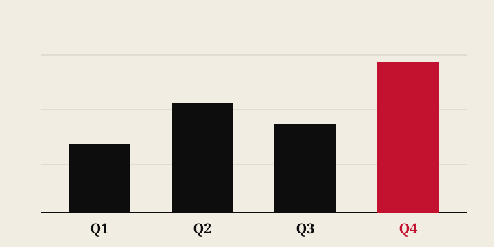

import coverImage from './cover.svg';
import chart from './chart.svg';

export const frontmatter = {
  title: 'Roadmap Rituals That Keep Teams Aligned',
  date: '2026-05-08',
  category: 'Product',
  summary: 'A practical playbook for making product roadmap reviews fast, clear, and stakeholder-friendly.',
  tags: ['Product', 'Roadmap', 'Execution'],
  coverImage,
};

# Roadmap rituals that still fit modern teams

The best roadmap rituals are not ceremonies. They are communication channels that keep the team in sync.

## What makes a strong ritual?

- A short prep window
- Clear decisions on what to build next
- A single source of truth for dependencies

### Example output

## Why this matters

A roadmap ritual should reduce ambiguity and make priorities visible. If you can point to a chart and explain why the next step matters, your team is more likely to move with confidence.
